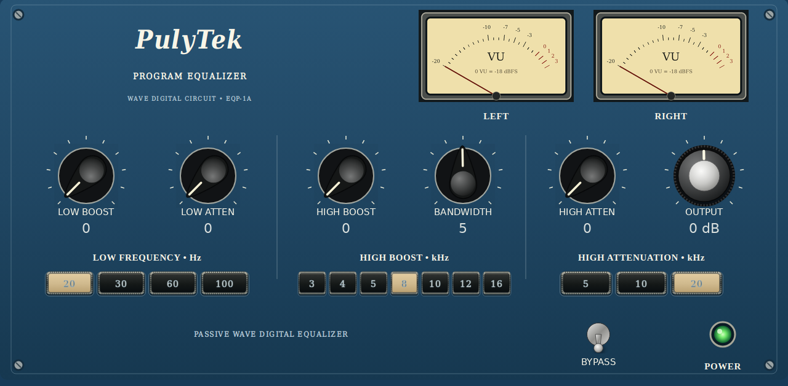
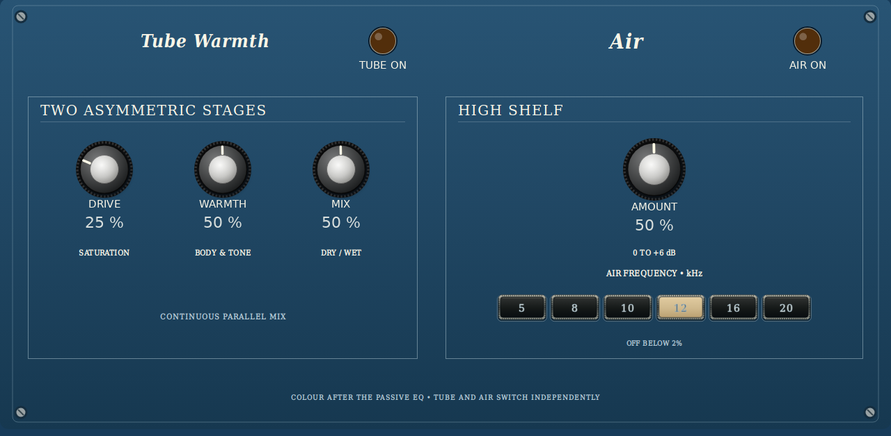
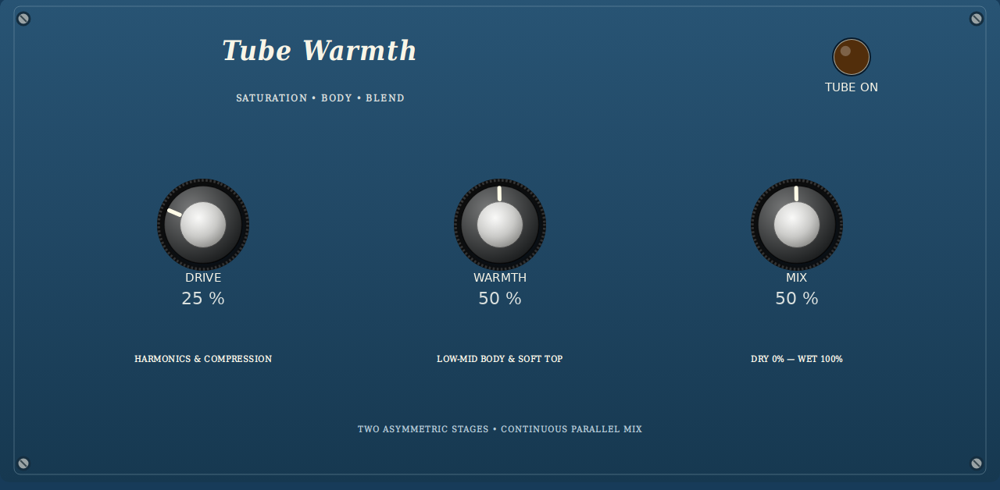

# PulyTek

A blue, vintage-style **Pultec-inspired EQ for Akai Force / MPC Gen1**, using the open-source
[EQP-WDF-1A circuit model by Alberto Barrera / ABSounds](https://github.com/ABSounds/EQP-WDF-1A).
A separate project maintained by MagicStino; GPLv3 with upstream and third-party notices preserved.







**Experimental release candidate.** Desktop DSP/host tests and ARM emulated loading with Force 3.9.1 libraries pass.
Physical Force/MPC testing and CPU benchmarking remain pending. The previews show the generated native skin,
not a device capture. No firmware is changed by this project.

## Sound and controls

**EQUALIZER** is the clean Pultec front. **TUBE & AIR** holds every colour control, including Tube DRIVE/WARMTH/MIX and AIR AMOUNT. **SIDE MIXING** holds the stereo EQ.

- Original WDF low boost/attenuation and high boost/attenuation curves, with bandwidth and output trim.
- **Tube Warmth**: two asymmetric stages with **DRIVE**, **WARMTH** and continuous **MIX** from 0–100%. This is an added colour stage,
  not a claim to reproduce a particular tube circuit. Off by default; mix defaults to 50%. [Design and measurements](docs/TUBE.md).
- **AIR**: optional **AMOUNT** (0–100%, mapping to 0–6 dB shelf boost) at **5, 8, 10, 12, 16 or 20 kHz**. Off by default; Amount defaults to 50% (+3 dB). The AIR lamp switches it independently of Amount, including at 0%.
- **Side Mixing**: switchable M/S processing, 0–200% stereo width and −24 to +12 dB side level.
  Four peaking bands affect the **side signal only**, each with 20 Hz–20 kHz frequency, ±12 dB gain and 0.2–10 Q.
  The middle signal is preserved; 100% keeps the original width and 0% folds to mono. Side Mixing is off by default.
- Stereo **VU meters**: rectified-average moving-coil-style ballistics, approximately 300 ms to 99%; **0 VU = −9 dBFS RMS**. The needle is an engine-driven
  native filmstrip, not the unsupported native Meter component. POWER is a static illuminated panel lamp;
  Tube, AIR and Side lamps follow their switches.
- Floating-point stereo processing preserves headroom. Full bypass returns the original audio exactly.
- All three pages have native touch controls and Q-Link banks. Dexed was inspected as a working format example;
  PulyTek's panel art is original and uses blue, cream lettering, ribbed switches and Bakelite-style knobs.

Signal order: passive WDF EQ → optional side matrix/EQ/width → AIR → tube colour/mix → output trim.
This is an EQ, not a stereo generator: width does not create side information from a mono input.

## Install

Download the portable `*-mpc-armv7.zip` from [Releases](https://github.com/MagicStino/pulytek/releases),
verify its SHA256 and follow [installation instructions](docs/INSTALL.md). Save your project before running
`install.sh`: the standard installer stops/restarts the MPC application and backs up its settings.
Insert PulyTek as an **audio effect**. Package acceptance in OpenPlugin is a separate maintainer review.

## Reproduce the native build

Linux x86-64 prerequisites: Python 3.12, Git, C/C++ compiler, readelf/binutils, fonts-dejavu-core and the Chromium
runtime dependencies installed by Playwright. Builds use the same pinned mpc-vst-plugins revision as Force OpenPlugin.

```sh
python3 -m venv .venv
.venv/bin/pip install -r requirements-build.txt
.venv/bin/python -m playwright install --with-deps chromium
export PATH="$PWD/.venv/bin:$PATH"
ZIG_PATH=$(python -c 'import ziglang,pathlib; print(pathlib.Path(ziglang.__file__).parent / "zig")')
python tools/test.py
python tools/build.py --target armv7 --zig "$ZIG_PATH"
python tools/check_skin.py
python tools/package.py
python tools/test_package.py
```

Outputs: `build/armv7/pulytek.so`, ELF validation, three generated TUI pages and Q-Link maps, `docs/preview_*.png`,
portable ZIP, checksum, full source snapshot and `dist/openplugin.json`. The root community manifest is updated
only after a package is actually published. Dependency commits, Python tools, Zig 0.15.2 and ZIP timestamps are pinned.
A complete corresponding source snapshot (including the pinned wrapper/tooling and licenses) ships in the package.

[Build and verify](https://github.com/MagicStino/pulytek/actions/workflows/build.yml) runs these checks in CI.
Its manually selected Publish option produces a prerelease and writes the release URL/hash into root `openplugin.json`.
Publishing is separate from installing on a device.

## Why the Force build is VST2

Force OpenPlugin and the working [Dexed port](https://github.com/sd88me/mpc-vst-dx7) register **native VST2 .so effects/instruments**
through `pluginList-arm`, paired with an Akai `Plugin Skins/TUI.json` and portable `mpc-plugin.json` package.
A desktop VST3 bundle has no installation path in that contract. PulyTek follows the actual native standard.
The generated skin uses the MPC OS 2.x structure read by OS 3.x, without claiming physical testing on older firmware.

The optional **Linux VST3** target shares the same DSP but uses JUCE's generic parameter editor. It does not use the
Akai skin and is not for installation through OpenPlugin. With CMake 3.22+, Ninja and JUCE's Linux build dependencies:

```sh
cmake -S . -B build/vst3 -G Ninja -DCMAKE_BUILD_TYPE=Release
cmake --build build/vst3 --target PulyTek_VST3 --parallel 2
```

CMake pins JUCE 7.0.12 by commit. An ARM Linux VST3 build requires a suitable CMake cross toolchain/sysroot;
the CI desktop build is x86-64, not proof of Force VST3 support.

Read [validation and remaining hardware checks](docs/VALIDATION.md), [OpenPlugin registration](docs/OPENPLUGIN.md)
and [attribution](NOTICE.md). Other component licenses are in `licenses/`.

Factory bank: **49 original presets**, with six each for Voice, Drums, Bass, Guitar, Keys, Bus, Master and Stereo, plus Init. See [preset guide](docs/PRESETS.md).

### OpenPlugin JSON loading

- Community bridge manifest: [openplugin.json](https://raw.githubusercontent.com/MagicStino/pulytek/main/openplugin.json). Validated against Force OpenPlugin’s `openplugin.community/1` validator. Main catalog inclusion follows its normal review process.
- Direct device catalog: [catalog.json](https://raw.githubusercontent.com/MagicStino/pulytek/main/catalog.json). Native `schema: 1` with one effect, exact ZIP URL, SHA256, byte size and `beta` channel. Tested with Force OpenPlugin’s actual native JSON parser. Maintainers can merge its `plugins` entry into the existing catalog; it is not a replacement for the full catalog. A loader configured to this feed sees only PulyTek.
- Installable portable ZIP: [PulyTek rc4](https://github.com/MagicStino/pulytek/releases/download/v0.1.0-rc4/PulyTek-0.1.0-rc4-mpc-armv7.zip), including internal `mpc-plugin.json`, interface assets, `.so`, installer and complete corresponding source. JSON describes the download; the ZIP supplies installation files.

The existing device “Add source” scanner reads GitHub’s latest **stable** release. It will not automatically discover this experimental prerelease; use the explicit catalog entry or manual installation. Hardware testing remains pending.
